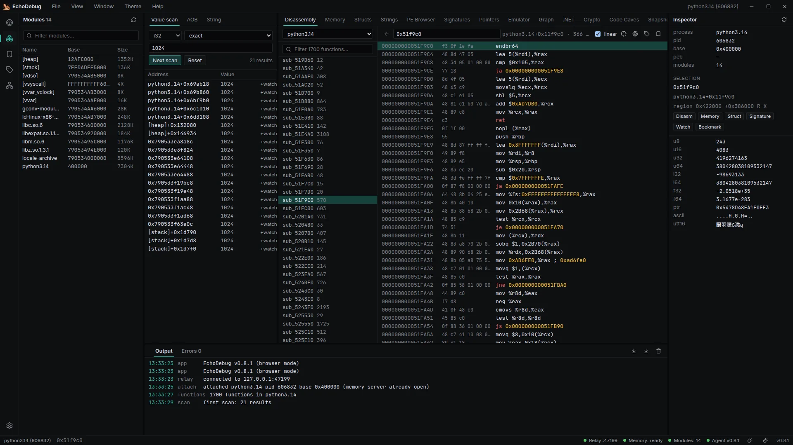
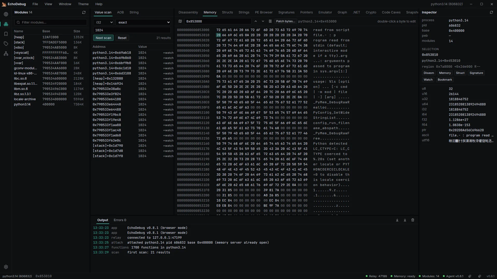
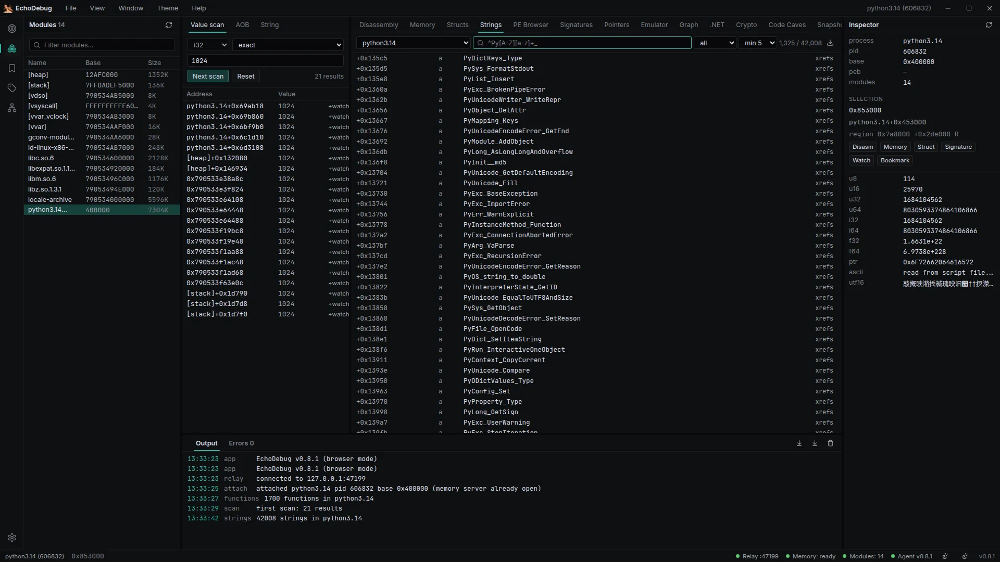
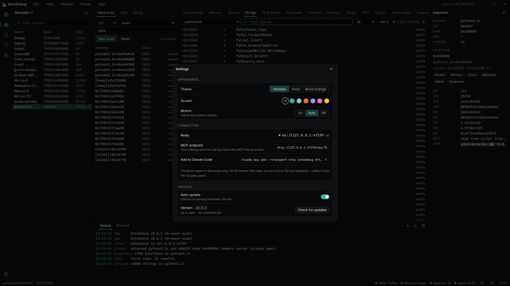

<p align="center"></p>

# EchoDebug

A Windows reverse-engineering workbench with Reverse-Slap's interface, the feature set of
Reverse-Slap and AiDA Private, and **Echo's hypervisor as its only backend**. It ships no kernel
driver, no mapper and no injected DLL. All process access goes through Echo's Universal API.



<table>
  <tr>
    <td><a href="docs/screenshots/memory.webp"></a></td>
    <td><a href="docs/screenshots/strings.webp"></a></td>
    <td><a href="docs/screenshots/settings.webp"></a></td>
  </tr>
  <tr align="center"><td>Memory</td><td>Strings</td><td>Settings</td></tr>
</table>

> [!WARNING]
> Use EchoDebug only on software and systems you own or are authorized to test. Memory writes and
> freezes can crash the target.

## How it fits together

```
Echo (Discord overlay host)                      EchoDebug.exe (Tauri)
┌────────────────────────────┐                   ┌──────────────────────────────┐
│ echo_debug.as              │── ws /ext ──────▶ │ relay  127.0.0.1:47110       │◀── React UI
│ process::open_socket ──────┼── ws /agent ────▶ │ MCP    POST /mcp             │◀── Claude Code / any MCP client
└────────────────────────────┘                   └──────────────────────────────┘
```

- **Echo's built-in memory server** (`process::open_socket`) serves reads, batch reads, modules,
  signature/string scans, RTTI, function enumeration and disassembly.
- **`agent/echo_debug.as`** adds everything Echo's server doesn't expose: attach, writes, region walk,
  pointer chains, the value scanner, pointer scan, Unicorn emulation, module dumps and freezing.
- **The desktop app** runs the relay. It routes every request to the right side, so the UI and
  external MCP clients all use the same verbs. See [PROTOCOL.md](PROTOCOL.md).

## Quick start

1. Download an installer from [Releases](https://github.com/NetVar1337/EchoDebug/releases/latest):
   `EchoDebug_x.y.z_x64-setup.exe` (per-user setup, no admin needed) or
   `EchoDebug_x.y.z_x64_en-US.msi` (per-machine, for managed deployment). Both auto-update.
2. Start EchoDebug. On every start it installs or updates the agent at `%APPDATA%\scripts\echo_debug.as`.
3. In Echo, open the menu and load `echo_debug.as`. It connects to the app automatically and keeps
   retrying if the app isn't running yet.
4. In **Targets**, pick a process and click **Attach**. The status bar should show
   `Memory server` and `Agent` as green.

## Linux / Ubuntu (preview build)

Releases also ship `EchoDebug_x.y.z_amd64.deb` (install with `sudo dpkg -i …` or the Software app)
and `EchoDebug_x.y.z_amd64.AppImage`. **Both auto-update**: the updater installs the same format
you installed (a .deb install asks for your password via pkexec to run `dpkg -i`). `latest.json`
on each release carries signed `linux-x86_64-deb` and `linux-x86_64-appimage` entries.

On Linux the Echo agent is unavailable (it runs inside Echo's Discord overlay on Windows), so the
relay serves a **local `/proc` backend** itself: attach by pid/name from Targets, then memory,
modules, region map, AoB/string scans, disassembly (iced-x86), ELF symbols, the value scanner, pointer
chains and pointer scans, freeze and watch, export lookup, the dynamic loader's module list
(`r_debug`/`link_map`), **Unicorn emulation** against the live image, **Itanium C++ RTTI**, an **ELF
browser**, and a **ptrace debugger** (int3 and DR0-DR3 hardware breakpoints, step, continue,
registers) all work against the local process (`/proc/<pid>/mem`: same user, or
`kernel.yama.ptrace_scope=0`).

## Features

| Area | What you get |
|---|---|
| Shell | Reverse-Slap layout: frameless title bar with File/View/Window/Theme/Help menus and window buttons, activity rail, targets/modules/watch/names/MCP panels, scanner, tabbed workspace, output, inspector, status bar, splitters, three themes plus accent colours, boot splash, global tooltips, motion preference (on/auto/off) |
| Navigation | The tab strip holds the views you use (close with × or middle-click, Ctrl+W; wheel scrolls it); **Views** (Ctrl+Shift+V) lists every view grouped as Code / Memory / Binary / Dynamic with a one-line description and search; Ctrl+K command palette also finds views by what they do; F1 lists every shortcut |
| Layout | Show or hide the side panel (Ctrl+B, or click the active rail icon), scanner (Ctrl+Alt+S), output (Ctrl+J) and inspector (Ctrl+Alt+I) from the status bar, View menu or palette; narrow windows fold the scanner and inspector away automatically; View → Reset tabs and panels |
| Feedback | Errors (and warnings while the output panel is hidden) appear as toasts; views that need a process offer one-click attach to recent targets; the process list puts targets you attached before first and hides kernel threads |
| Navigation | Ctrl+G go-to, **Ctrl+Shift+P command palette** over every action, Alt+← back in the disassembly, X for xrefs, N to rename, `;` to comment, A to assemble, F3 next match, **Ctrl+Z / Ctrl+Y undo and redo** for names, comments and struct types |
| Targets & modules | Local process list, attach by pid/name, module list, open a module in PE/Strings/Disassembly/Memory, dump to `scripts\dmp` |
| Disassembly | Function list (`enumerate_functions` merged with `.pdata` bounds), virtualized listing, clickable branch targets with history, xrefs (rel32 + RIP-relative), inline strings / reference counts / switch-case counts, regex search over the listing or the whole module, **in-place patching** with a built-in x86-64 assembler (NOP, invert or force a jump), make-signature, bookmarks, names and comments, export as `.asm` or a C array |
| CFG | Basic blocks of the function at the cursor with taken / fall-through / jump / switch-case edges (MSVC, GCC and absolute jump tables), blocks of natural loops (found from dominator back edges) highlighted, zoom and fit |
| Pseudocode | CFG → **Pseudocode**: *structured pseudocode (experimental)*: if/else, while, do-while and goto where structuring fails, common x64 instructions as C-like statements (`*(u32*)(rbp - 0x4) = ecx;`, `rax = sub_401000(rcx, rdx);`, folded `cmp`+`jcc` conditions), everything else kept as the asm line in a comment. Registers stay registers; no types or variables are recovered |
| Memory | Live hex/ASCII view with change highlighting, range selection, find (bytes with wildcards, ASCII, UTF-16, typed values) forward and backward, copy as hex / C / Rust / Python / base64 / IDA, fill and paste, labels and bookmarks in the grid, data inspector (both byte orders, double-click to write), region map |
| Structs | ReClass-style typed fields, follow pointers, RTTI class names, **guess the fields from live memory**, track which fields change, export as C++ / C / IDAPython / Ghidra / Binary Ninja / ReClass.NET (`.rcnet`, best effort); **auto-detect** proposes a type per slot with its evidence (vtable with RTTI name, module/heap/code/string pointers, float/double, small int/bool, inline ASCII/UTF-16, padding) to accept one by one or all at once; **compare instances** shows the layout read at 2–16 objects (or a pointer array such as an entity list) side by side with differing and constant fields marked; **engine presets** for Unreal (UObject, FName, FNamePool/entry, TArray, FString, GUObjectArray, UWorld/ULevel/AActor basics), Unity IL2CPP (object, string, array, class) and Source 2 (entity identity/instance), with version notes and "typical" offsets flagged |
| RTTI | Every class the module declares, with its base class and the vftables that belong to it; resolve any live object to its vtable and the virtual functions behind it. GCC/Clang (Itanium ABI) classes on Linux |
| Scanner | Cheat Engine-style first/next value scan (u8–u64, i8–i64, f32/f64, bytes, string, wstring; exact/unknown/changed/increased/…) with rounded / truncated / epsilon float matching, alignment and address ranges; below 50,000 candidates the app narrows them itself with **undo** and **save / load**; **group scans** (several values at fixed offsets); AOB (IDA pattern) scan, string scan |
| Watchlist | Live values, inline edits, freeze (rewritten by the agent at 20 Hz), bookmarks |
| Alerts | Conditions on an address + type (equals, not equals, changed, greater, less; numbers, bytes, strings) checked by the Windows agent at 50 Hz; one-shot or repeating; each hit sends an `alert_event` with a memory snapshot around the address, logged to Output (click to view the snapshot) and to Echo's console |
| Strings | ASCII + UTF-16 extraction, category/regex filters, CSV export, xrefs per string |
| PE browser | Headers, sections, data directories, imports (with IAT slots), exports, **Analysis tab** with per-section entropy and packer/protector heuristics, **Details** (Rich header with checksum check, TLS callbacks, relocations, debug directory, imphash, Authenticode signer and digest check), **Resources** (icons, version info, manifest, dialogs, string tables), **PDB symbols** from the Microsoft symbol server (or `ECHODEBUG_SYMBOL_SERVERS`), cached and checked by GUID/age; an ELF browser for Linux modules |
| Signatures | IDA-style sigmaker for code or raw bytes, auto-wildcards rel32/disp32, grows until unique, IDA / `\x..`+mask / byte-array / x64dbg / YARA output, saved to a catalog; **FLIRT** signature files (IDA `.sig`, versions 5-10) can be loaded and matched against the module, with the CRC of the function tail verified. **Sig Tools**: catalog health check (OK / moved / missing / ambiguous against the RVA each signature was saved at, update every moved one in one click, export the report) with automatic repair, batch sigmaker, FLIRT `.pat` / `.sig` generation |
| YARA | A YARA engine for module images and memory ranges: text (nocase / wide / ascii / fullword / xor), hex (wildcards, nibbles, jumps, alternatives) and regex strings, the usual conditions (of-sets, counts, offsets, at / in, filesize, entrypoint, uintXX), rule references, private and global rules |
| Pointers | Live pointer-chain resolver, bounded pointer scan whose results load straight into the resolver |
| Call graph | The function under the cursor with its direct callees (from Echo's own disassembly) and the call sites that reference it; a module mode that draws the whole binary at once |
| Xrefs | The whole reference graph of a module indexed in one pass: who points here, what this points at, and the most referenced addresses in the binary |
| .NET explorer | ECMA-335 metadata parsed straight out of the loaded module: namespaces, types, methods, fields, base types, **IL disassembly** of method bodies (all opcodes, exception clauses, tokens resolved), user strings with the methods that load them |
| Crypto scanner | Finds known constant tables (AES S-box, SHA-256 K/H, MD5 T, CRC-32, Blowfish, ChaCha/Salsa sigma, TEA delta, Base64 alphabet, Rijndael mix) |
| Code caves | Padding runs inside executable sections (0xCC / 0x90 / 0x00) with their size and section |
| Snapshots | Capture up to 16 MiB of process memory (large captures go to IndexedDB), diff two captures byte by byte, across sessions, export and import |
| BinDiff | Match the live module's functions against an older build on disk (names, exact and structural hashes, call graph, mnemonic similarity), list changed / added / removed functions, carry names over, export CSV |
| Unpack | Find the original entry point with the emulator, recover the import table from the live IAT, save a rebuilt PE (raw = virtual layout, entry = OEP, new import section) |
| Decrypt | Run a string-decryption routine at every call site in the emulator and list the strings each call produced |
| Binary map | Module section layout as a proportional bar plus the live region map with protection flags |
| Patches | Every write EchoDebug makes is journalled with the bytes that were there before, and can be reverted with one click; **patch sets** save patches by module + RVA, apply them again only where the original bytes are still there, and can re-apply on every attach of the same build |
| Triage | The imports of a module that deserve a second look (memory tampering, injection, anti-analysis), each with the callsites that use it |
| Anti-debug | The places a module tries to find out whether it is analysed: INT 2D, the red-pill descriptor reads, VMCALL, PEB/TEB reads, timing checks, the debugger-detection APIs and the debugger window names in the strings |
| Emulator | Unicorn emulation against the live process image (the process is never modified): registers, instruction trace linked to the disassembly, a **memory log** of every read and write (address, size, value before and after), and a **decrypt oracle** that feeds a buffer into a routine and reads the result back; register-change traces with a step slider, xmm/ymm registers and the regions mapped during the run |
| Debugger (Linux) | ptrace: attach every thread, int3 and hardware (DR0-DR3) breakpoints, step, continue, pause, registers with editing, breakpoint bytes hidden from reads |
| Script | Async JavaScript against an `ed` API (verbs, memory, journaled writes, names, disassembly, every app analysis), saved scripts |
| MCP server | `http://127.0.0.1:47110/mcp` (Streamable HTTP JSON-RPC 2.0, batch supported, token-protected), the backend tools plus **`ui_*` tools served by the app window** (PE details, strings, xrefs, CFG, assembler, YARA, FLIRT, IL, struct guessing, binary diff, unpacking, batch decryption, …) and tools that read and set your names and comments, list and revert journalled patches and list saved signatures, 16 prompts, 4 resources, server-sent notifications (`GET /mcp`) and progress streaming; the **MCP Server** panel shows the endpoint, connect command, tool catalog with a live call tester, prompt/resource lists and a real-time `tools/call` log |
| Watch streaming | The agent samples watched addresses at 10 Hz and broadcasts `watch_event` (old/new hex) — MCP clients get push-style updates without polling `read` |
| Sessions | Export/import the whole workspace (theme, watchlist, bookmarks, names, struct layout) as one JSON file; names export as an IDA `.idc` or Ghidra script. **Module projects** keep names, comments and bookmarks per module build (by RVA) and restore them on the next attach, wherever ASLR puts the module; when a module's build changes, its saved items are **re-located** by a signature made per name and bookmark (Names panel → Sign), with matched / moved / lost counts, and project exports also carry the signature catalog; panel sizes, the last place in each view and (optionally) the last target are restored on start; a target switcher in the Targets panel |
| MCP policy | Settings in the MCP panel: allow everything, **ask** (an Allow/Deny dialog in the window for writes, freezes and dumps) or read-only, plus allow/deny tool lists, an optional audit file (`mcp-audit.jsonl`) and JSONL export. Tools carry MCP annotations and structured output; resource templates (`echodebug://memory/{address}/{size}`, `module/{name}/exports`, …) and argument completion are supported |
| Lifter | **Lifter** tab (and `lift_block` / `lift_trace` / `devirt` tools): x86-64 lifted to expressions with symbolic execution. **Block** shows each instruction's effect, dead code and the branch condition (constant = opaque predicate); **Deobfuscate trace** emulates a function against the live process, slices away junk, push/pop noise and dead stores, simplifies formulas (MBA included) and folds loops (`[rdi + i] = [rsi + i] ^ 0x5a for i in 0..n`); **Devirtualize** finds a VM's dispatcher, lifts each handler, guesses the VIP register and lists the virtual instruction stream. Scratch buffers for pointer arguments are one checkbox away |
| Agent extras | Emulation with API stand-ins (unpackers and decryptors run to the end), unpacking-layer detection, register-change traces, zero-filled unmapped reads and xmm registers; Emu Debugger watchpoints, conditional breakpoints and snapshots; typed watches with conditions, hit counts and history; add/clamp freezes in groups; backend snapshot diffs; pointer maps compared across restarts; object instances by vtable; backend xref scans; multi-threaded scans; cancel, stats and a write journal; an **EchoDebug** tab inside Echo with status and safety switches; settings in `echodebug/agent.json` |
| Emulated debugger | **Emu Debugger** tab: a persistent Unicorn session over the target's memory — step, run to an address, breakpoints, edit registers and memory, watch the stack — without touching the process (`emu_*` verbs, also as MCP tools) |
| Hook scanner | **Hooks** tab: executable code compared with the file on disk (rebased with its relocations), inline hooks at exports, IAT slots redirected to unbacked memory |
| Monitors | **Monitors** tab: module load/unload timeline and page-change monitors (4 KiB page hashes), as events and MCP notifications, on every backend |
| Engine dumpers | **Engines** tab: Unreal Engine 4.23+/5 (GNames/GObjects → object list and an `SDK.hpp`; also legacy GNames for UE4.22 and older, FName decoding by index, GUObjectArray paged and searched without a full dump, addresses found by shape, typed in or via editable AOB patterns), Unity IL2CPP (global-metadata.dat v24–31 from disk or memory → `dump.cs` and an Il2CppDumper-style `script.json` with method RVAs) and Source engine netvars (`netvars.txt`) |
| Headless | `echodebug-relay [port]` runs the relay and MCP server without the UI; `echodebug-relay --stdio` serves MCP over stdin/stdout for clients that launch servers as subprocesses |
| Updates | Signed auto-update from GitHub Releases: checks at startup and every 30 min, downloads in the background, then a **Restart to update** button (status bar, Help menu, Settings); an update left pending installs at the next launch. Help → Check for updates on demand. The Echo agent updates with the app |

**Not available on the Echo backend:** the native debugger (breakpoints, stepping, VEH), Frida,
kernel inspection, network capture/proxy, and Reverse-Slap/AiDA's decompilers and .NET decompiler.
Echo exposes no API for these, and EchoDebug deliberately ships no driver to replace them (the
debugger exists on the Linux local backend, through ptrace). One target is attached at a time; the
Targets panel switches between recent targets. FLIRT files in IDA 9.5's version 11 format are not
read yet: that layout is not publicly documented.

### Connecting an MCP client

```bash
claude mcp add --transport http echodebug http://127.0.0.1:47110/mcp --header "Authorization: Bearer <token>"
```

The MCP Server panel shows this command with your token filled in. The relay listens on `127.0.0.1`
only, requires the token on `/client` and `/mcp` (stored in `<config>/EchoDebug/relay-token`;
`ECHODEBUG_TOKEN` overrides it, `ECHODEBUG_AUTH=0` turns the check off) and rejects browser origins
other than the app's own, so other programs and web pages cannot reach your target's memory.
**Regenerate token** (Settings or the MCP Server panel) replaces the stored token; the relay switches
at once and MCP clients must be re-added with the new command.

For stdio clients: `claude mcp add echodebug -- echodebug-relay --stdio`.

Any MCP client works: the relay speaks Streamable HTTP JSON-RPC 2.0 (`initialize`, `ping`,
`tools/list`, `tools/call`, `prompts/list|get`, `resources/list|read|subscribe|templates/list`,
`completion/complete`; batches supported,
notifications answered with `202`; `GET /mcp` with `Accept: text/event-stream` streams resource updates
and agent events; a `tools/call` with a `progressToken` streams scan progress). Prompts:
`explain_function`, `find_pattern`, `find_string`, `pointer_path`, `scan_value`, `triage_module`,
`find_vtable`, `make_signature`, `diff_snapshots`, `unpack_module`, `decrypt_strings`,
`deobfuscate_function`, `devirtualize`, `find_value_references`, `rebuild_class`,
`update_signatures_after_patch`. Resources:
`echodebug://status`, `echodebug://tools`, `echodebug://mcp/log`, `echodebug://target/modules`. Tools
named `ui_*` and the annotation tools (`list_names`, `set_name`, `list_comments`, `set_comment`,
`list_patches`, `revert_patch`, `list_signatures`) run in the app window; with only the headless relay
they answer with a clear error. `revert_patch` writes target memory, so the ask / read-only policy
applies to it.

## Development

Requirements: Node 22+, Rust (stable, 1.90+), on Windows the WebView2 runtime and MSVC build tools, on Linux CMake and a C compiler (the relay builds Unicorn for the local emulator).

```bash
npm ci
npm run tauri dev            # desktop app with hot reload
npm run dev                  # UI only in a browser (needs a relay: cargo run -p echo-debug-relay --manifest-path src-tauri/Cargo.toml),
                             # then open http://localhost:1420/?token=<contents of ~/.config/EchoDebug/relay-token>
npm test                     # frontend unit tests (PE/ELF/.NET parsers, assembler, CFG, YARA, FLIRT, diff, unpacking, struct auto-detect, engine readers, …)
npm run test:e2e             # end-to-end UI test against a live process (Linux: gcc, cargo, playwright)
cargo test -p echo-debug-relay --manifest-path src-tauri/Cargo.toml   # relay, local backend, ptrace, Unicorn, PDB
node scripts/lint-agent.mjs <echo-angelscript-lsp checkout> agent/echo_debug.as
# agent tests: compiles echo_debug.as with the real AngelScript engine against mocks of Echo's API
cmake -S tests/agent -B build/agent-tests && cmake --build build/agent-tests -j && ctest --test-dir build/agent-tests --output-on-failure
```

The agent tests (`tests/agent/`) need CMake and a C++17 compiler; CMake fetches the pinned AngelScript SDK.
`echo_mock.as` stands in for Echo's API (one fake target, scriptable Unicorn/Zydis, captured `ws::send`),
and every function in `namespace tests` of `agent_tests.as` is a test.

### Releases are automatic

Use [Conventional Commits](https://www.conventionalcommits.org/). Every push to `main`:

1. runs CI (frontend, relay, AngelScript lint and tests, Windows `cargo check`);
2. computes the next version from commits since the last tag (`feat` → minor, `fix`/`perf`/`refactor`/`revert` → patch,
   `!`/`BREAKING CHANGE` → major; minor while < 1.0). `docs`/`chore`/`ci`/`test` alone don't release;
3. writes the version into `package.json`, `Cargo.toml`, `Cargo.lock` and the agent, then commits `chore(release): vX.Y.Z`
   and pushes the `vX.Y.Z` tag;
4. builds the signed NSIS setup and MSI installers, publishes the GitHub release with notes, `latest.json` and `echo_debug.as`.

Installed apps pick up the release on their next start. You can force a release with **Actions → Release → Run workflow**.
The updater signing key is the `TAURI_SIGNING_PRIVATE_KEY` repo secret. If it's lost, existing installs
can no longer verify updates. Dependabot keeps npm, cargo and Actions dependencies current.

## Credits

- UI/UX and logo from [Reverse-Slap](https://github.com/kaizer1308/reverse-slap) by kaizer1308; features after
  [AiDA Private](https://github.com/sigwl/AiDAPrivate) by sigwl. The code here is new: neither
  project has a license, so no code was copied from them.
- [Echo](https://echo-23.gitbook.io/angel) Universal API. Ideas from
  [web-mv](https://github.com/Jozkah/web-mv), [angel-menu-mcp](https://github.com/Jozkah/angel-menu-mcp),
  [echo-angelscript-lsp](https://github.com/speedsunderscore/echo-angelscript-lsp) (used for the agent lint),
  [as_bundler](https://github.com/sinistercodes/as_bundler), [Signature-Doctor](https://github.com/b4rzY/Signature-Doctor),
  [Dumper-7](https://github.com/Encryqed/Dumper-7) and [echo-esp-preview](https://github.com/speedsunderscore/echo-esp-preview).
- [AngelScript](https://www.angelcode.com/angelscript/) SDK (zlib license), built by the agent test host.

Licensed under GPL-3.0.
